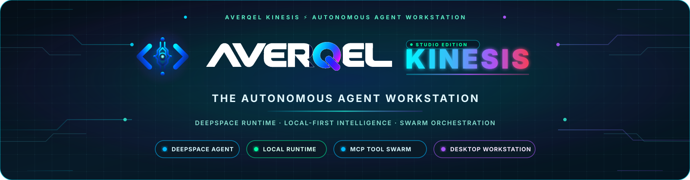

<p align="center">
  
</p>

<p align="center">
  <a href="https://github.com/sainibhaowal/AverQel-Kinesis/releases/tag/v1.0.0"></a>
  <a href="#"></a>
  <a href="https://github.com/sainibhaowal/AverQel-Kinesis"></a>
  <a href="LICENSE"></a>
  <a href="#"></a>
  <a href="#"></a>
  <a href="#"></a>
  <a href="#"></a>
</p>

---

# AverQel Kinesis ⚡

> **The Autonomous Agent Desktop Studio & Local Execution Workstation.**
> An ultra-high-performance, research-grade engineering harness unifying autonomous multi-agent swarms, self-healing execution loops, persistent goal trajectory trees, and native MCP tool brokerage into an air-gapped, local-first desktop operating shell.

---

## 🛰️ Executive Abstract

**AverQel Kinesis** is the native execution substrate for advanced agentic intelligence. Engineered for developers, AI researchers, and autonomous system architects, Kinesis decouples intelligence from cloud dependencies by running an embedded, deterministic agent runtime directly on local hardware.

At its core sits the **DeepSpace Swarm Engine**, a reactive execution daemon capable of continuous task decomposition, multi-turn state compaction, dynamic goal progression, and self-healing error recovery. Wrapped in a hardware-accelerated **Electron 44** shell with dedicated IPC boundary enforcement, Kinesis bridges foundation models (OpenAI Codex, Anthropic Claude, Google Gemini, Ollama) with real-world local tools, Linux pseudo-terminals (PTY), Language Server Protocol (LSP) diagnostics, and official Model Context Protocol (MCP) ecosystems.

---

## ⚡ System Architecture

```mermaid
flowchart TD
    %% TIER 1: CLIENT PRESENTATION & DESKTOP SHELL
    %% TIER 1: CLIENT PRESENTATION & DESKTOP SHELL (4 CARDS ACROSS)
    subgraph T1 ["1. DESKTOP WORKSTATION SHELL (ELECTRON 44 & NEXT.JS 16)"]
        direction LR
        UI["<b>Interactive Studio Interface</b><br/>• Next.js 16.3 & React 19.2<br/>• Reactive DeepSpace Goal Bar<br/>• Realtime Trajectory & Diff Stream"]
        IPC["<b>Typed Preload IPC Bridge</b><br/>• contextIsolation: true<br/>• Node 22 Sandboxed Host RPC"]
        Loopback["<b>Air-Gapped Gateway</b><br/>• 127.0.0.1:11030 Loopback<br/>• Zero Cloud Telemetry"]
        UI <-->|"Secure RPC"| IPC <-->|"HTTP/WS Bridge"| Loopback
        UI["<b>Interactive Studio Interface</b><br/>• Next.js 16.3 & React 19.2<br/>• Reactive DeepSpace Goal Bar<br/>• Trajectory Stream & Diff Inspector"]
        ShellHost["<b>Native Desktop Workstation</b><br/>• Electron 44 & Node 22 LTS<br/>• Wayland & X11 GPU Compositor<br/>• Native Window Lifecycle Guard"]
        IPC["<b>Typed Preload IPC Bridge</b><br/>• contextIsolation: true<br/>• Sandboxed Host RPC Bus<br/>• Strict Zero-Eval Policy"]
        Loopback["<b>Air-Gapped Local Gateway</b><br/>• 127.0.0.1:11030 Loopback<br/>• Zero Cloud Telemetry<br/>• High-Speed Local Asset Server"]
    end

    %% TIER 2: DEEPSPACE AUTONOMOUS ENGINE
    subgraph T2 ["2. DEEPSPACE AUTONOMOUS ENGINE (PYTHON 3.12 CORE)"]
        API["<b>FastAPI Gateway (Port 11000)</b><br/>• Duplex WebSockets, SSE & REST Endpoints"]
        TaskLoop{{"<b>Self-Healing Task Loop (task_loop.py)</b><br/>• Trajectory Evaluation & Continuous Self-Reflection<br/>• Automatic Linter/Runtime Error Interception & Rollback State"}}
        API["<b>FastAPI Gateway & Core Service Host (Port 11000)</b><br/>• Duplex WebSockets, Realtime SSE Trajectory Streams & OpenAPI Endpoints"]
        TaskLoop{{"<b>Self-Healing Task Loop (task_loop.py)</b><br/>• Trajectory Evaluation & Continuous Self-Reflection<br/>• Automatic Error Interception, Patching & Rollback State"}}
        
        GoalEngine["<b>Deterministic Goal Engine</b><br/>• Active | Paused | Blocked | Complete<br/>• Step Budget Supervisor (max_goal_rounds)"]
        PlanReview["<b>Plan Mode & Review Gates</b><br/>• Step-by-Step Task Decomposition<br/>• Human-in-the-Loop Verification"]
        SwarmBroker["<b>Subagent Swarm Coordinator</b><br/>• Parallel Persona Delegation<br/>• Git Worktree Branch Isolation"]
        subgraph T2_Orch ["Deterministic Governance & Swarm Coordination"]
            direction LR
            GoalEngine["<b>Deterministic Goal Engine</b><br/>• Active | Paused | Blocked | Complete<br/>• Step Budget Supervisor"]
            PlanReview["<b>Plan Mode & Auto-Review</b><br/>• Multi-Step Task Decomposition<br/>• Human-in-the-Loop Verification"]
            SwarmBroker["<b>Subagent Swarm Coordinator</b><br/>• Parallel Persona Swarm Delegation<br/>• Git Worktree Branch Isolation"]
        end

        API <==>|"Control Plane"| TaskLoop
        TaskLoop <-->|"Goal State"| GoalEngine
        TaskLoop <-->|"Step Review"| PlanReview
        TaskLoop <-->|"Persona Dispatch"| SwarmBroker
        TaskLoop <--> GoalEngine
        TaskLoop <--> PlanReview
        TaskLoop <--> SwarmBroker
    end

    %% TIER 3: EXECUTION MATRIX & TOOL BROKERAGE
    %% TIER 3: EXECUTION MATRIX & TOOL BROKERAGE (4 CARDS ACROSS)
    subgraph T3 ["3. TOOL SUBSTRATE & MODEL MULTIPLEXER MATRIX"]
        direction LR
        MCPHost["<b>Universal MCP Broker (v1.30)</b><br/>• Stdio & SSE Transport Broker<br/>• PostgreSQL, SQLite, GitHub, Filesystem"]
        PTYSandbox["<b>Kernel PTY Terminal Shell</b><br/>• Linux Process Virtualization<br/>• Streaming ANSI Terminal Supervisor"]
        LSPEngine["<b>Language Intelligence Hub</b><br/>• Real-time LSP Diagnostics<br/>• AST Code Symbol & Definition Index"]
        ModelMesh["<b>Model Multiplexer Gateway</b><br/>• OpenAI Codex & GPT-4o<br/>• Claude 3.5, Gemini 2.0, Local Ollama"]
    end

    %% TIER 4: LOCAL SOVEREIGNTY & PERSISTENCE
    %% TIER 4: LOCAL SOVEREIGNTY & PERSISTENCE (4 CARDS ACROSS)
    subgraph T4 ["4. LOCAL DATA SOVEREIGNTY & PERSISTENCE ENGINE"]
        direction LR
        SQLiteDB[("<b>Embedded SQLite Engine</b><br/>• knowledge.db<br/>• Session Trajectories & Graphs")]
        VectorStore[("<b>Local Neural Vector DB</b><br/>• sqlite-vec & SentenceTransformers<br/>• Semantic Memory & Context Retrieval")]
        FileVault[("<b>Workspace Storage Vault</b><br/>• ~/.averqel-harness/storage<br/>• Checkpoints & Artifact Patches")]
        EventBus[("<b>In-Memory Event Broker</b><br/>• FakeRedis In-Process Dispatcher<br/>• High-Speed Pub/Sub Event Bus")]
    end

    %% INTER-TIER PIPELINES
    Loopback ===>|"127.0.0.1 Loopback RPC"| API
    UI ===>|"Renderer Events"| API
    ShellHost ===>|"Process Signals"| API
    IPC ===>|"Secure Host RPC"| API
    Loopback ===>|"127.0.0.1 Assets"| API
    
    TaskLoop ===>|"Tool Calls"| MCPHost
    TaskLoop ===>|"Process Sandbox"| PTYSandbox
    TaskLoop ===>|"LSP Diagnostics"| LSPEngine
    TaskLoop ===>|"Model Routing"| ModelMesh

    MCPHost -->|"Audit Log"| SQLiteDB
    LSPEngine -->|"Embeddings"| VectorStore
    PTYSandbox -->|"Diff Checkpoints"| FileVault
    API -->|"Event Dispatch"| EventBus
    TaskLoop -->|"Event Bus"| EventBus

    %% SEMANTIC THEME STYLING
    classDef clientStyle fill:#081325,stroke:#00e5ff,stroke-width:1.5px,color:#e2f8ff;
    classDef coreStyle fill:#0e122b,stroke:#a855f7,stroke-width:1.5px,color:#e2f8ff;
    classDef toolStyle fill:#061c24,stroke:#00ffa3,stroke-width:1.5px,color:#e2f8ff;
    classDef storeStyle fill:#181022,stroke:#f43f5e,stroke-width:1.5px,color:#e2f8ff;

    class UI,IPC,Loopback clientStyle;
    class UI,ShellHost,IPC,Loopback clientStyle;
    class API,TaskLoop,GoalEngine,PlanReview,SwarmBroker coreStyle;
    class MCPHost,PTYSandbox,LSPEngine,ModelMesh toolStyle;
    class SQLiteDB,VectorStore,FileVault,EventBus storeStyle;

    style T1 fill:#050b14,stroke:#00e5ff,stroke-width:1px,stroke-dasharray: 4 4;
    style T2 fill:#080b1a,stroke:#a855f7,stroke-width:1px,stroke-dasharray: 4 4;
    style T2_Orch fill:#0b0e24,stroke:#a855f7,stroke-width:1px;
    style T3 fill:#040f14,stroke:#00ffa3,stroke-width:1px,stroke-dasharray: 4 4;
    style T4 fill:#0d0814,stroke:#f43f5e,stroke-width:1px,stroke-dasharray: 4 4;
```



---

## 🔬 Core Engineering Innovations

### 1. DeepSpace Self-Healing Autonomous Task Loop

* **Non-Blocking Reactive Execution**: The `task_loop` service evaluates execution trajectories turn-by-turn, autonomously detecting runtime errors, linter violations, and environment anomalies to execute automatic rollbacks and corrective interventions.
* **Deterministic Goal Engine**: Track multi-step session milestones via the reactive `DeepSpaceGoalBar`. Goals transition deterministically across `active`, `paused`, `blocked`, and `complete` phases, enforcing strict round constraints (`rounds_started / max_goal_rounds`) to eliminate runaway execution loops.
* **Plan & Auto-Review Mode**: Deconstructs massive software development tasks into discrete, verifiable execution steps with human-in-the-loop checkpoints or fully autonomous pass-through approvals.

### 2. Subagent Swarms & Branch Isolation

* **Parallel Persona Delegation**: Spin up dedicated, domain-specific subagents (`Codebase Researcher`, `Database Engineer`, `Systems Architect`, `Security Auditor`) on independent background threads.
* **Worktree-Level Workspace Isolation**: Each subagent operates within isolated scratch trees or dedicated Git worktrees (`git worktree`), ensuring experimental modifications never corrupt production branches.

### 3. Unified Model & Tool Context Protocol (MCP)

* **Production MCP Server Host (SDK v1.30)**: Built-in, high-throughput Model Context Protocol client powering native stdio and SSE connections to industry-standard MCP servers (PostgreSQL, SQLite, GitHub, Linear, Jira, Discord, Composio, Puppeteer, Slack).
* **Multiplexed Provider Mesh**: Effortlessly toggle or orchestrate swarms across:
  * **OpenAI Codex & GPT-4o**
  * **Anthropic Claude 3.5 Sonnet & Haiku**
  * **Google Gemini 2.0 Flash & Pro**
  * **Local Ollama & Open-Source LLMs (DeepSeek-R1, Qwen 2.5, Llama 3.3)**
  * **Local Neural Embeddings**: `sqlite-vec` with `SentenceTransformers` on PyTorch CPU for fast, air-gapped semantic search.

### 4. Multimodal Intelligence & Sensory Substrate

* **Local Speech & Acoustic Intelligence**: Integrated `faster-whisper` for low-latency on-device voice transcription and `kokoro-onnx` neural voice synthesis for real-time auditory execution telemetry.
* **Live Agent Streaming**: Powered by `livekit-agents` for bidirectional duplex real-time streaming and multimodal sensory input.
* **Document & OCR Vision Engine**: Embedded `paddleocr` and `pypdfium2` for local document extraction, diagram parsing, and image analysis.

### 5. Hardware-Accelerated Local Desktop Shell

* **Native Linux Wayland/X11 Compositing**: Built on Electron 44 with explicit GPU rendering safeguards (`disable-features: Vulkan`) to guarantee zero-flicker stability across Linux distributions (Pop!_OS, Ubuntu, Debian, Arch) as well as macOS and Windows.
* **Loopback Asset Protection**: Internal web assets are served over a secure, authenticated local loopback server (`local-frontend.cjs`), completely avoiding `file://` origin security vulnerabilities and hydration errors.
* **Zero-Cloud Data Sovereignty**: All session states, conversation histories, goal revisions, and workspace indexes reside strictly in local SQLite and on-disk files.

### 6. Zero-Docker Local Operating Substrate

* **Embedded In-Memory Event Broker**: Powered by `fakeredis` and eager in-process Celery runners, eliminating the requirement for external Docker daemons or heavyweight Redis containers.
* **Columnar Analytics Engines**: Integrated `duckdb` and `polars` for lightning-fast local OLAP querying over structured datasets and trajectory telemetry.

---

## 📊 Capability & Specification Matrix

| Metric / Dimension | AverQel Kinesis Specification |
| :--- | :--- |
| **Execution Architecture** | Dual-Tier: Electron 44 Workstation + Python 3.12 FastAPI Asynchronous Core |
| **Frontend Framework** | Next.js 16.3.8 + React 19.2.3 with Tailwind CSS & PostCSS |
| **Agent Paradigm** | Autonomous Multi-Turn Reactive Swarm with Self-Healing Error Reflection |
| **Tool Protocol** | Official Model Context Protocol (MCP) SDK v1.30 (Stdio & SSE Transports) |
| **Terminal Integration** | Real-time PTY terminal virtualization with ANSI stream formatting and process supervision |
| **Language Intelligence** | Real-time LSP (Language Server Protocol) code diagnostics & AST symbol extraction |
| **Neural Vector Engine** | Local `sqlite-vec 0.1.6` + `SentenceTransformers 5.6` on PyTorch CPU |
| **Speech & Multimodal** | On-device `faster-whisper 1.2` + `kokoro-onnx 0.5` + `livekit-agents 1.7` |
| **Data Analytics** | High-performance `duckdb 1.5.6` + `polars 1.27` local columnar engines |
| **Event Bus & Tasks** | Zero-Docker embedded `fakeredis 2.40` event broker + in-process Celery |
| **Supported OS Targets** | Linux (`.deb`, unpacked), Windows (`.exe` NSIS), macOS (`.dmg` Universal Binary) |
| **Data Retention** | 100% Local-First: Embedded SQLite Knowledge Base + Local Checkpoint Artifacts |
| **Hardware Acceleration** | Wayland / X11 Compositor with automated GPU feature gating |
| **Runtime Networking** | Desktop: Ports 11000 (API) / 11030 (UI) \| Dev: Ports 10000 (API) / 10030 (UI) |

---

## 🚀 Quickstart & Installation

### Prerequisites

* **Node.js**: `>= 22.12.0 LTS`
* **Package Manager**: `pnpm >= 9.0.0`
* **Python**: `>= 3.12` with standard venv tooling

### 1. Clone & Bootstrap Workspace

```bash
git clone https://github.com/sainibhaowal/AverQel-Kinesis.git
cd AverQel-Kinesis
```

### 2. Launch Native Desktop Workstation

To start the complete AverQel Kinesis desktop studio with hot-reloading:

```bash
./start-local.sh desktop
```

### 3. Launch Local Web & API Engine

To launch the background DeepSpace daemon and Next.js interface for browser use:

```bash
./start-local.sh all
```

### 4. Build Production Desktop Installers

Generate production packages tailored for your operating system:

```bash
# Linux (.deb package)
cd applications/desktop && pnpm run build:linux

# Windows (.exe installer)
cd applications/desktop && pnpm run build:windows

# macOS (.dmg universal binary)
cd applications/desktop && pnpm run build:mac
```

---

## 🗂️ Repository Anatomy

```
AverQel-Kinesis/
├── applications/
│   └── desktop/                 # Electron 44 native shell, IPC bridge, window lifecycles
│       ├── electron/            # Main process runtime, local frontend loopback, geometry
│       ├── assets/              # AppStream XML metadata, desktop entries, 512px icon assets
│       └── tests/               # Automated test suite (32/32 passing desktop runtime tests)
├── frontend/                    # Next.js 16 reactive interface & DeepSpace UI surfaces
│   ├── app/dashboard/deepspace/ # Realtime goal bar, trajectory stream, tool call rendering
│   ├── components/              # Atomic UI primitives, provider dialogs, telemetry markups
│   └── lib/                     # Brand tokens, MCP client bindings, realtime event streaming
├── backend/                     # Python 3.12 DeepSpace autonomous agent core
│   ├── app/deepspace/           # Task loop, goal projection, session surfaces, LSP & PTC tools
│   ├── app/integrations/        # MCP catalog, endpoint security, expanded server providers
│   ├── app/providers/           # Multi-model inference multiplexer (Codex, Claude, Gemini, Ollama)
│   └── tests/                   # Unit & integration verification suites
└── Docs/                        # High-resolution architectural schematics and brand banners
```

---

## 🛡️ Security, Privacy & Anti-Piracy Standard

AverQel Kinesis is built under the **Zero-Trust Local Workstation Principle**:

* **Strict Network Isolation**: Local agent operations, workspace searches, and shell commands never leave the host system unless an external cloud model or external MCP provider is explicitly selected.
* **100% Local Data Sovereignty**: All session logs, vector embeddings, goal trajectories, and code artifacts reside exclusively on your local disk. There is zero telemetry, zero analytics tracking, and zero background data collection.
* **Anti-Piracy and Code Integrity**: AverQel Kinesis contains no pirated assets, leaked confidential code, or unauthorized proprietary weights. All components are either original open-source contributions or licensed under permissive upstream licenses.
* **Process Sandboxing**: PTY terminal commands run with explicit current working directory scoping to prevent inadvertent traversal outside the project workspace.
* **Context Isolation**: Electron renderers run with `contextIsolation: true`, preventing remote web code from executing privileged Node.js APIs.

---

## ⚖️ Open-Source Credits, Attributions & Trademarks

AverQel Kinesis is made possible through the research, engineering, and contributions of the global open-source community:

* **Model Context Protocol (MCP)**: Developed by Anthropic PBC under open source.
* **Desktop & Interface Infrastructure**: Electron (OpenJS Foundation), Next.js (Vercel, Inc.), and React (Meta Platforms, Inc.).
* **Backend & Intelligence Core**: FastAPI (Sebastián Ramírez), PyTorch (Linux Foundation), Hugging Face Transformers, SentenceTransformers (UKP Lab), DuckDB (DuckDB Foundation), Polars (Ritchie Vink), LiveKit (LiveKit Inc.), and Faster Whisper (Systran).
* **Storage & Vectors**: SQLite (D. Richard Hipp), `sqlite-vec` (Alex Garcia), and `fakeredis` (Daniel Nephin, Bruce Merry).

For complete itemized licensing terms and copyright texts, see [THIRD_PARTY_NOTICES.md](THIRD_PARTY_NOTICES.md). For trademark usage policies and nominative fair-use disclaimers, see [TRADEMARKS.md](TRADEMARKS.md). All third-party trademarks, product names, and logos belong to their respective owners; their mention does not imply endorsement, affiliation, or sponsorship.

---

## 📜 License

Licensed under the **Apache License, Version 2.0**. See the [LICENSE](LICENSE) file for terms and conditions.

---

<p align="center">
  <b>AverQel Kinesis</b> : Engineered with precision for autonomous software intelligence.
</p>
